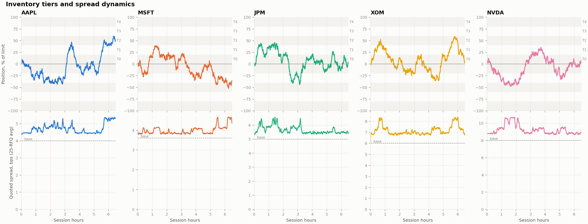
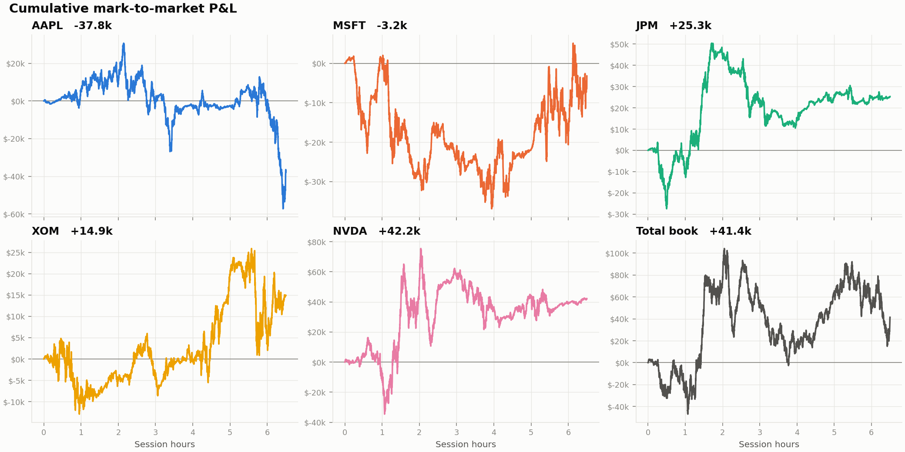

# Inventory-Contingent Market Maker

A Python market-making simulator that quotes bid-offer prices on five equities
(AAPL, MSFT, JPM, XOM, NVDA) in response to simulated hedge fund requests-for-quote.

- **Reference prices** follow geometric Brownian motion (5-second ticks, one 6.5h session).
- **Hedge fund flow** arrives as RFQs. Each client has a price tolerance around the
  reference price and trades only if the quote is inside it. About 10% of the flow is
  *informed*: those clients trade in the direction of the next five minutes' move.
- **Quoting** centres on the reference price and skews asymmetrically across five
  inventory tiers (by |position| / limit):

  | Tier | Utilisation | Accumulating side | Reducing side |
  |------|-------------|-------------------|---------------|
  | T0 | < 20% | 1.00x half-spread | 1.00x |
  | T1 | 20-40% | 1.30x | 0.85x |
  | T2 | 40-60% | 1.75x | 0.70x |
  | T3 | 60-80% | 2.50x | 0.50x |
  | T4 | 80-100% | 4.00x | 0.30x |

  When long, the bid widens (so it is harder to sell to us) and the offer tightens
  (so it is easier to buy from us). A side whose fill would breach the hard
  position limit is not quoted.

## Results (seed 7, one session)

11,661 RFQs and 9,348 trades. Clients fill less often as inventory climbs the tiers,
which is the skew doing its job of slowing accumulation:

| Tier | RFQs | Hit rate | Avg quoted spread |
|------|------|----------|-------------------|
| T0 | 6,337 | 84% | 5.95 bps |
| T1 | 4,081 | 78% | 6.16 bps |
| T2 | 1,243 | 65% | 7.15 bps |





## Run

```bash
python3 -m venv .venv && .venv/bin/pip install numpy pandas matplotlib
.venv/bin/python simulate.py            # --steps, --seed, --out, --no-plots
```

## Output (`output/`)

| File | Contents |
|------|----------|
| `rfqs.csv` | Every request: client, side, size, reference, bid/ask, spread, tier, filled |
| `trades.csv` | Every executed trade, with edge vs reference in bps |
| `positions.csv` | Positions in all five names and total P&L after every trade |
| `pnl.csv` | Per-tick mark-to-market P&L by asset and in total |
| `cumulative_pnl.png` | Cumulative P&L for each asset and the whole book |
| `spread_dynamics.png` | Inventory against the tier bands, and the quoted spread, for each asset |

## Files

- `market_maker.py`: assets, tiers, price feed, quoting engine, client flow
- `simulate.py`: simulation loop and CSV logging
- `plots.py`: Matplotlib charts
